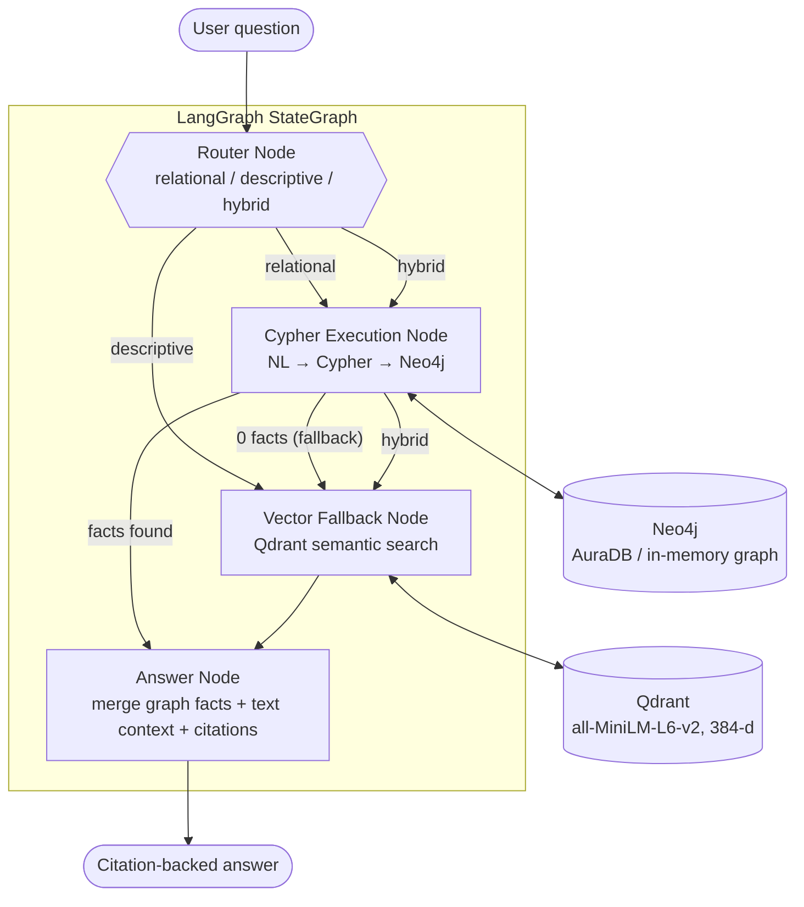
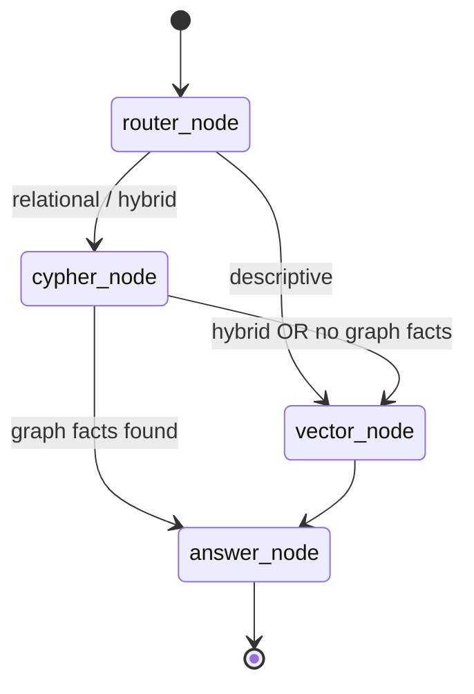
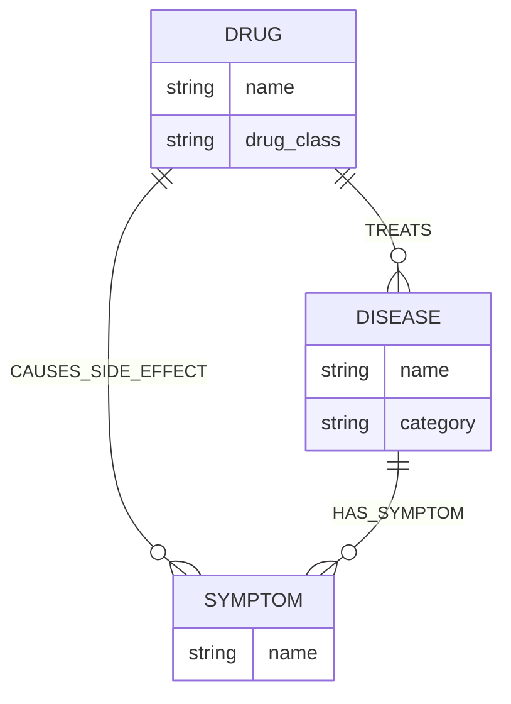
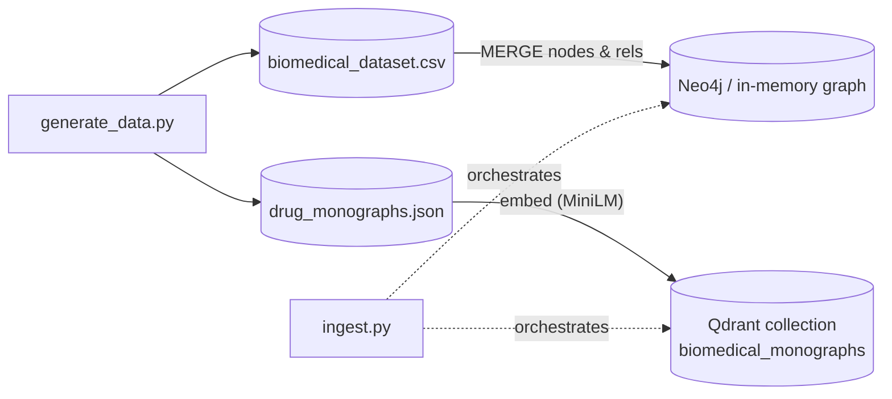

# 🧬 Biomedical & Drug Query Agent — Hybrid Graph + Vector RAG

A **LangGraph** agent that answers biomedical questions by combining a **Neo4j knowledge graph** (exact, factual drug–disease–symptom relations via Cypher) with a **Qdrant vector store** (descriptive pharmacology and mechanism-of-action context).

**Why hybrid?** Pure vector search can hallucinate or miss direct relations such as *"which drugs treat Type 2 Diabetes?"*. Graph lookups answer relational questions deterministically. Vector search covers the open-ended "how / why" questions.

<p align="center">
  
</p>

---

## 📑 Table of Contents
1. [Architecture](#-architecture)
2. [LangGraph Orchestrator](#-langgraph-orchestrator)
3. [Knowledge Graph Schema](#-knowledge-graph-schema)
4. [Ingestion Pipeline](#-ingestion-pipeline)
5. [Screenshots](#-screenshots)
6. [Project Structure](#-project-structure)
7. [Quickstart](#-quickstart)
8. [Connecting Neo4j AuraDB](#-connecting-neo4j-auradb-optional)
9. [Example Queries](#-example-queries)
10. [Limitations](#-limitations)

---

## 🎯 Architecture



## 🧭 LangGraph Orchestrator

| Node | Responsibility |
| :--- | :--- |
| **Router** | Keyword/intent check: *relational* ("What drugs treat…"), *descriptive* ("How does … work?") or *hybrid* (both in one question). |
| **Cypher Execution** | [`CypherGenerator`](src/cypher_generator.py) turns the question into a parameterised, case-insensitive Cypher lookup and runs it on Neo4j. |
| **Vector Fallback** | Embeds the question and retrieves the top-3 drug monographs from Qdrant. Also triggered when the graph returns nothing. |
| **Answer** | Merges graph rows and monograph text into a Markdown answer with FDA / PubMed citations. |



## 🕸️ Knowledge Graph Schema



- **3 node labels:** `(:Drug)`, `(:Disease)`, `(:Symptom)`
- **3 relationship types:** `[:TREATS]`, `[:CAUSES_SIDE_EFFECT]`, `[:HAS_SYMPTOM]`
- **Data:** 121 curated records (46 drugs, 69 diseases, 196 symptoms/side effects) in [`data/biomedical_dataset.csv`](data/biomedical_dataset.csv), generated by [`generate_data.py`](generate_data.py).
- **Vector corpus:** 46 drug monographs in [`data/drug_monographs.json`](data/drug_monographs.json).

> [!NOTE]
> The dataset is **hand-curated for demonstration**, not an authoritative clinical source. Citation IDs (PMIDs/NDA numbers) should be verified before any real use. Not medical advice.

## 🔄 Ingestion Pipeline



## 📸 Screenshots

All screenshots are captured from the running Streamlit app.

### Relational query → Neo4j Cypher
*"What drugs treat Type 2 Diabetes?"*


### Relational query: side effects
*"What side effects does Metformin cause?"*


### Descriptive query → Qdrant vector search
*"How does Metformin work?"*


### Hybrid query → Graph + Vector
*"What drugs treat Asthma and how does Albuterol work?"*


### Automatic vector fallback (0 graph facts)
*"What treatments help with chronic kidney failure hyperfiltration?"*


### Knowledge Graph Explorer


### Vector Monograph Explorer


## 📁 Project Structure

```
├── app.py                    # Streamlit UI (agent, graph explorer, vector explorer)
├── ingest.py                 # Loads graph + vector store
├── generate_data.py          # Builds the CSV and monograph JSON
├── test_agent.py             # 5-scenario end-to-end test
├── src/
│   ├── agent.py              # LangGraph orchestrator
│   ├── cypher_generator.py   # NL → Cypher
│   ├── graph_db.py           # Neo4j driver + in-memory fallback
│   ├── vector_db.py          # Qdrant + embeddings
│   └── config.py
├── data/                     # CSV, monographs, local Qdrant storage
├── https://raw.githubusercontent.com/meenub255/Biomedical-Drug-query-agent/assets/
├── requirements.txt
└── .env.example
```

## 🚀 Quickstart

```bash
git clone https://github.com/meenub255/Biomedical-Drug-query-agent.git
cd Biomedical-Drug-query-agent
pip install -r requirements.txt

python ingest.py          # build graph + vector index
python test_agent.py      # run the 5 test scenarios
streamlit run app.py      # launch the UI
```

With no Neo4j credentials the app uses an **in-memory graph** that mimics the Cypher patterns used here, so it works out of the box.

## 🔑 Connecting Neo4j AuraDB (optional)

1. Create a free instance at [Neo4j Aura](https://neo4j.com/cloud/platform/aura-graph-database/).
2. Copy `.env.example` to `.env` and fill in:
   ```env
   NEO4J_URI=neo4j+s://<instance-id>.databases.neo4j.io
   NEO4J_USERNAME=neo4j
   NEO4J_PASSWORD=<password>
   ```
3. Re-run `python ingest.py` to write the graph to AuraDB.

## 🧪 Example Queries

| Type | Query | Path |
| :--- | :--- | :--- |
| Relational | What drugs treat Type 2 Diabetes? | Router → Cypher → Answer |
| Relational | What side effects does Metformin cause? | Router → Cypher → Answer |
| Descriptive | How does Metformin work? | Router → Vector → Answer |
| Hybrid | What drugs treat Asthma and how does Albuterol work? | Router → Cypher → Vector → Answer |
| Fallback | What treatments help with chronic kidney failure hyperfiltration? | Router → Cypher (0) → Vector → Answer |

## ⚠️ Limitations

- Routing and Cypher generation are **rule-based** (no LLM); unusual phrasings may fall back to vector search. An LLM text-to-Cypher step is a natural next upgrade.
- The answer node assembles text from retrieved data rather than generating prose with an LLM.
- Live AuraDB mode has not been exercised against a real instance in this repo's tests; the default tested path is the in-memory graph.
